<div align="center">

# HETERO-WORLD

### Consensus forecasts for robot fleets in mixed traffic, via Wasserstein barycenters of heterogeneous world models


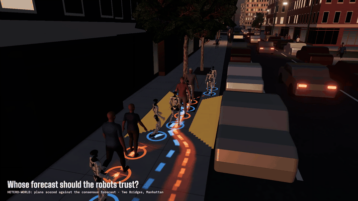

**[▶ Full 1080p60 video (44 s)](figures/video/hetero_world_twobridges_1080p60.mp4)** ·
**[Interactive WebGPU viewer](#-the-digital-twin)** ·
**[Math](#-method-the-math)** ·
**[Results](#-results)** ·
**[Reproduce](#-reproduce-everything)**

</div>

---

Six delivery humanoids share a Manhattan sidewalk that narrows to **1.0 m** at a street-tree pit. Each robot runs a *different*
learned world model (diffusion, JEPA, RSSM). They can broadcast what they think will happen next; the pedestrians broadcast nothing.

> **Whose forecast of the pedestrians should the robots trust?**

The obvious answer, *pool every robot's rollouts and pick the safest-looking plan* (**Union**), has a trap: each plan is judged against the
pedestrian future **predicted inside that same rollout**, so the optimiser drifts toward whichever model happened to forecast the most
convenient pedestrian. That is the optimizer's curse. **HETERO-WORLD** fuses the fleet's forecasts into one consensus measure, an
**entropic Wasserstein barycenter**, and scores *every* candidate plan against that same consensus.

<table>
<tr>
<td width="50%">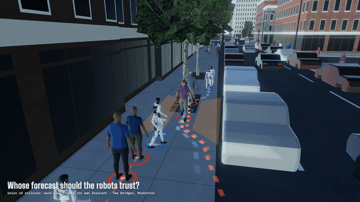</td>
<td width="50%">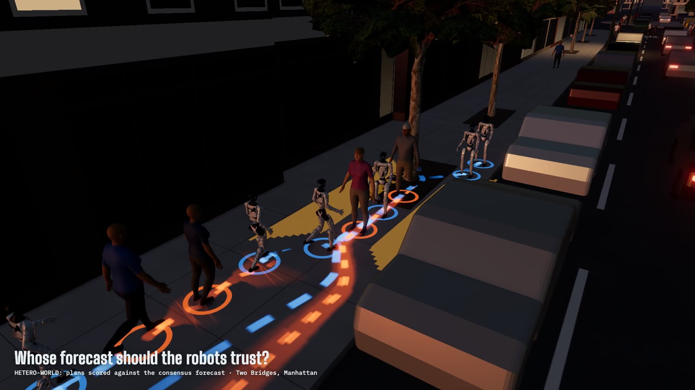</td>
</tr>
<tr>
<td align="center"><b>A · Union of rollouts</b>: each plan trusts its own forecast</td>
<td align="center"><b>B · HETERO-WORLD</b>: plans scored against the consensus forecast</td>
</tr>
</table>

## ⚡ TL;DR: what holds up and what does not

| | Finding | Evidence |
|---|---|---|
| ✅ | **Calibrated fusion on real pedestrians.** The barycenter forecast has a better energy score than the mixture of the same three models in **15/15** ETH/UCY scene–seed runs. | Wilcoxon p = 1e-4 |
| ✅ | **More robots get through.** With learned world models, completion is **+20.3 points** over Union. | 74.0% vs 53.7%, n = 300, p<sub>Holm</sub> = 2e-7 |
| ✅ | **Holds on the hardest real sidewalk type** (12 m pinch): **+16.7 points** completion over Union. | n = 150, p<sub>Holm</sub> = 0.009 |
| ⚠️ | **Not safer.** Safety is on par in most settings, and in two settings it is significantly *worse* than Union on any-collision rate: learned models + 2 faulty robots (+9.0 points, p = 0.01) and NYC type 2 (+14.7 points, p = 0.02). | see [results](#-results) |
| ⚠️ | **Not a better point forecast.** The barycenter does not beat the best single model (RSSM) or constant velocity on ADE. | ETH/UCY table |

The claim we defend is narrow and testable: **a consensus forecast that is better calibrated than the mixture, without knowing which model
is best, and that lets more robots complete the pinch at comparable safety.**

---

## 🧮 Method: the math

### 1 · Every robot's forecast is an empirical measure over joint futures

Robot $i \in \{1,\dots,M\}$ runs its own world model $\mathcal W_i$ and samples $N$ joint futures of the whole scene over a horizon of
$H$ plan steps:

$$
x_i^{(n)} \in \mathbb R^{H \times A \times 2},\qquad
\mu_i \;=\; \frac1N \sum_{n=1}^{N} \delta_{x_i^{(n)}} ,
$$

with $A$ agents (robots and pedestrians), $H = 20$ steps of $\Delta t_{\text{plan}} = 0.25$ s (a 5 s horizon) and $N = 100$ rollouts.
Rollouts are broadcast in float16 *in physical coordinates*, so no weights, latents or gradients ever cross between models.

### 2 · Entropic optimal transport (log-domain Sinkhorn)

For two empirical measures with uniform weights $a = \tfrac1N\mathbf 1,\ b = \tfrac1K\mathbf 1$ and cost
$C_{nk} = \lVert y^{(n)} - x^{(k)}\rVert_2^2 / s$, where the scale $s$ makes $\varepsilon$ dimensionless:

$$
\mathrm{OT}_\varepsilon(\nu,\mu) \;=\; \min_{P \in U(a,b)} \;\langle P, C\rangle \;-\; \varepsilon\, H(P),
\qquad U(a,b) = \{P \ge 0 : P\mathbf 1 = a,\ P^\top \mathbf 1 = b\}.
$$

The dual potentials are iterated in the log domain for numerical stability ($\varepsilon = 0.01$, 50 iterations):

$$
f_n \leftarrow -\varepsilon \log \sum_k \exp\!\Big(\tfrac{g_k - C_{nk}}{\varepsilon}\Big) + \varepsilon \log a_n,
\qquad
g_k \leftarrow -\varepsilon \log \sum_n \exp\!\Big(\tfrac{f_n - C_{nk}}{\varepsilon}\Big) + \varepsilon \log b_k,
$$

$$
P_{nk} = \exp\!\Big(\tfrac{f_n + g_k - C_{nk}}{\varepsilon}\Big).
$$

### 3 · The consensus: a free-support Wasserstein barycenter

$$
\nu^\star \;=\; \operatorname*{arg\,min}_{\nu = \frac1N\sum_a \delta_{y^{(a)}}} \;\sum_{i=1}^{M} \alpha_i\, \mathrm{OT}_\varepsilon(\nu, \mu_i),
\qquad
\alpha_i \propto \mathbb 1[\text{robot } i \text{ active and its broadcast received}].
$$

Atoms move by the $\alpha$-weighted barycentric projection (Cuturi & Doucet 2014, step size 1; 3 outer iterations). Dividing by the realised
row mass keeps the update unbiased when Sinkhorn is truncated:

$$
y^{(a)} \;\leftarrow\; \sum_{i=1}^{M} \alpha_i\, \frac{\sum_n P_i[a,n]\, x_i^{(n)}}{\sum_n P_i[a,n]} .
$$

Under packet loss every receiver $r$ builds its **own** $\nu^\star_r$ from the broadcasts it actually received ($\alpha_{r,i}=0$ for lost
packets), so no robot uses information it did not get.

### 4 · Scoring a candidate joint plan

Each candidate $\tau$ (a received rollout's robot part) gets the same deterministic score in every robot, so robots that share the inputs pick
the same plan without negotiating. With safety distance $d_{\text{safe}} = 2r + m = 2(0.3) + 0.2 = 0.8$ m and $[z]_+ = \max(z,0)$:

$$
J(\tau) \;=\;
\underbrace{\lambda \sum_{t}\sum_{i<j} \big[d_{\text{safe}} - \lVert p_i^t - p_j^t\rVert\big]_+^2}_{\text{robot–robot}}
+ \underbrace{\lambda \sum_{t,i} \big[\,\mathrm{pen}_{\text{wall}}(p_i^t) + 0.05\big]_+^2}_{\text{walls}}
- \underbrace{\sum_{i} \big(u_i^{H} - u_i^{0}\big)}_{\text{progress}}
+ \underbrace{\lambda_{\text{c}}\, \lVert \tau - \tau_{\text{prev}}^{\to}\rVert^2}_{\text{consistency}}
+ \underbrace{\lambda\, \mathbb E_{\xi}\Big[\sum_{t}\sum_{r,h} \big[d_{\text{safe}} - \lVert p_r^t - \xi_h^t\rVert\big]_+^2\Big]}_{\text{robot–pedestrian}}
$$

with $\lambda = 1000$ and $\lambda_{\text{c}} = 20$. **The methods differ only in where the pedestrian futures $\xi$ come from:**

| Method | Pedestrian futures $\xi$ in the robot–pedestrian term | What goes wrong |
|---|---|---|
| **Union** | $\xi = \tau_{\text{ped}}$: the pedestrians **inside the same rollout** | $\min_\tau J(\tau; \tau_{\text{ped}})$ rewards optimistic forecasts (optimizer's curse) |
| **Mixture** | $\xi \sim \tfrac1M \sum_i \mu_i$, resampled $N$ times | inherits every model's error, including the worst model's |
| **HETERO-WORLD** | $\xi \sim \nu^\star_{\text{ped}}$, the barycenter's pedestrian marginal | |
| Const. velocity | $\xi$ = straight-line extrapolation of current pedestrian velocity | ignores interaction |
| Oracle | $\xi$ = the simulator's true reactive pedestrians under the previous plan | upper bound, not deployable |

The selected plan is tracked by a shared MPC over motion primitives (speeds down to −0.3 m/s, so robots can back off), replanning every 5 steps.

### 5 · Evaluation statistics

**Forecast quality (ETH/UCY).** The energy score is a strictly proper scoring rule for multivariate forecasts, so it rewards calibration and
not just the mean:

$$
\mathrm{ES}(F, y) \;=\; \mathbb E_{X\sim F}\lVert X - y\rVert \;-\; \tfrac12\, \mathbb E_{X,X'\sim F}\lVert X - X'\rVert .
$$

**Closed-loop rates.** 95% Wilson intervals for a rate $\hat p$ over $n$ episodes:

$$
\frac{\hat p + \frac{z^2}{2n} \pm z\sqrt{\frac{\hat p(1-\hat p)}{n} + \frac{z^2}{4n^2}}}{1 + \frac{z^2}{n}},\qquad z = 1.96 .
$$

**Paired tests.** All planners run on *identical* scenarios, so comparisons are paired per episode. Two-sided exact McNemar test on the
discordant counts $b$ (only ours fails) and $c$ (only the other fails), Holm-corrected across the compared methods, plus a paired bootstrap
95% CI (2000 resamples) of the rate difference:

$$
p \;=\; \min\!\Big(1,\; 2\sum_{i=0}^{\min(b,c)} \binom{b+c}{i}\, 2^{-(b+c)}\Big),
\qquad
p^{\text{Holm}}_{(k)} = \max_{j\le k}\ \min\!\big(1, (m-j+1)\, p_{(j)}\big).
$$

---

## 🔁 Workflow

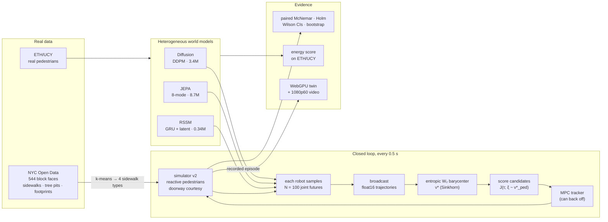

**Compute path.** World models trained on Kaggle GPUs (3 families × 3 seeds, fixed step budgets) → closed-loop campaigns as 25-episode shards
on a resumable queue (`scripts/job_queue.py`), split between an Apple M1 and a 13-CPU vast.ai box → `scripts/analyze.py` → figures, the WebGPU
twin, and the video. A re-run of one shard on the x86 box reproduced **25/25** episode outcomes from the M1. Four of those episodes differed
in trajectory details through floating-point drift; no outcome changed.

---

## 📊 Results

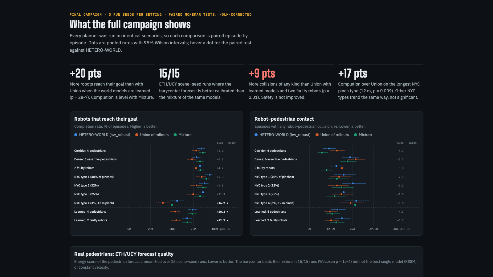

**10,200 closed-loop episodes**: 3 run seeds × 100 episodes per method (50 for the NYC types); 10 agents per scene (6 robots + 4 pedestrians, or 4 + 6 in the dense setting), simulated at 10 Hz.
Values are pooled rates over the three seeds. **✱** = p<sub>Holm</sub> < 0.05 for ours vs Union. Brackets are paired bootstrap 95% CIs of the difference (points).

| Setting | n / method | Completed % (ours · Union · Mixture) | Robot–ped. contact % (ours · Union · Mixture) | Ours − Union, completed | Ours − Union, any collision |
|---|---:|---|---|---|---|
| Corridor, 4 pedestrians | 300 | 84.3 · 78.3 · 86.0 | 11.3 · 16.0 · 7.3 | +6.0 [−0.3, +12.3], p=0.34 | −3.7 [−9.3, +2.0], p=1.00 |
| Dense: 6 assertive pedestrians | 300 | 78.7 · 73.3 · 82.7 | 23.7 · 27.0 · 22.3 | +5.3 [−1.0, +11.3], p=0.34 | −1.3 [−7.7, +5.0], p=1.00 |
| 2 faulty robots | 300 | 82.7 · 78.0 · 83.0 | 15.7 · 19.0 · 10.0 | +4.7 [−1.7, +10.7], p=0.51 | −2.7 [−9.0, +3.3], p=1.00 |
| NYC type 1 (40% of pinches) | 150 | 94.0 · 84.7 · 90.0 | 20.0 · 17.3 · 16.0 | +9.3 [+2.7, +16.0], p=0.06 | +6.7 [−2.7, +16.0], p=0.81 |
| NYC type 2 (32%) | 150 | 88.0 · 78.7 · 86.0 | 25.3 · 16.0 · 18.7 | +9.3 [+0.7, +17.3], p=0.15 | **+14.7 [+5.3, +24.7], p=0.02 ✱** (worse) |
| NYC type 3 (25%) | 150 | 86.0 · 74.7 · 82.7 | 20.0 · 18.7 · 14.7 | +11.3 [+2.7, +20.7], p=0.10 | +6.7 [−3.3, +16.0], p=0.74 |
| NYC type 4 (3%, 12 m pinch) | 150 | 56.0 · 39.3 · 50.0 | 27.3 · 24.0 · 26.7 | **+16.7 [+6.7, +26.7], p=0.009 ✱** | +2.0 [−7.3, +11.3], p=1.00 |
| Learned, 4 pedestrians | 300 | 74.0 · 53.7 · 73.7 | 16.3 · 12.0 · 13.3 | **+20.3 [+13.0, +27.7], p=2e−7 ✱** | +6.3 [+0.7, +12.3], p=0.11 |
| Learned, 2 faulty robots | 300 | 67.7 · 55.0 · 68.0 | 19.0 · 12.7 · 15.7 | **+12.7 [+5.3, +20.0], p=0.002 ✱** | **+9.0 [+2.7, +15.3], p=0.01 ✱** (worse) |

**Real pedestrians (ETH/UCY, leave-one-scene-out, 5 scenes × 3 seeds):**

| Forecast | Energy score ↓ (mean ± sd, 15 runs) | ADE of the mean ↓ (m) |
|---|---|---|
| **Wasserstein barycenter (ours)** | **4.33 ± 0.76** | 0.69 |
| RSSM (best single model) | 4.54 ± 1.02 | 0.56 |
| Mixture of the three models | 4.65 ± 0.87 | 0.82 |
| Constant velocity | 4.70 ± 1.08 | 0.55 |
| JEPA | 6.87 ± 2.23 | 0.96 |
| Diffusion | 6.93 ± 1.27 | 1.06 |

The barycenter beats the mixture in **15/15** runs (Wilcoxon p = 1e-4). It is not significantly better than RSSM (6/15) or constant velocity (9/15).
Its value is that the fleet does **not need to know which model is best**.

---

## 🏙 The digital twin

### WebGPU street viewer (`docs/hw_viewer/`)

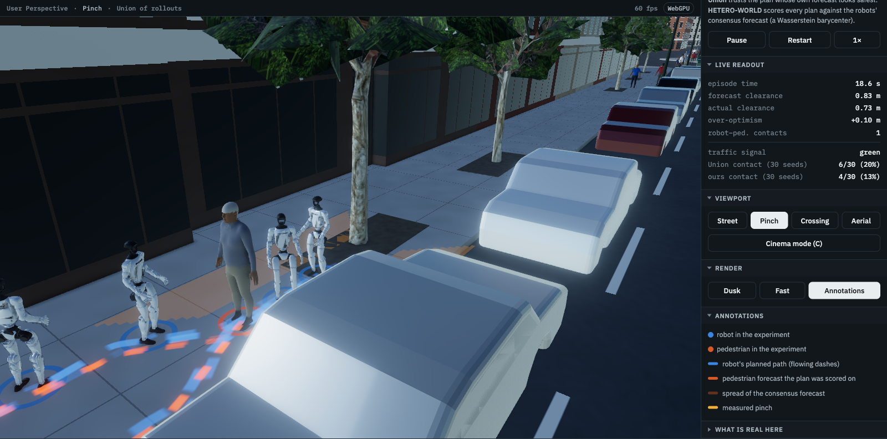

A Blender-style editor around a live **three.js r186 `WebGPURenderer`** (automatic WebGL2 fallback):

- **Real block.** NYC Open Data building footprints with roof heights, planimetric sidewalks, tree pits and 2015 Street Tree Census positions around the measured pinch (40.7125, −73.9980), set in a procedural street grid.
- **Rendering.** GTAO ambient occlusion, bloom, 4× MSAA, a physical sky with matching image-based light, PCF shadows, and day ↔ dusk lighting with lit windows, street lamps and headlights.
- **Life.** Signalised one-way traffic with car-following (IDM) and pedestrians crossing on the red phase. About 80 **NVIDIA SOMA-X** bodies are animated entirely on the GPU through vertex-animation textures: 10 body shapes, one draw call.
- **The experiment.** Six **Unitree G1** humanoids (MuJoCo Menagerie model) and four pedestrians replay a recorded episode. Robot plans flow as blue dashes and the scored pedestrian forecast as orange dashes, with a soft band for the consensus spread and fading dashed motion tails. The Union ↔ HETERO-WORLD A/B switch and the live clearance readout sit in the side panel.
- **Measured.** 60 fps with every frame under 19 ms in all views and in cinema mode (Apple M1, Chrome, WebGPU). The final campaign charts sit below the viewport.

<table>
<tr>
<td width="33%">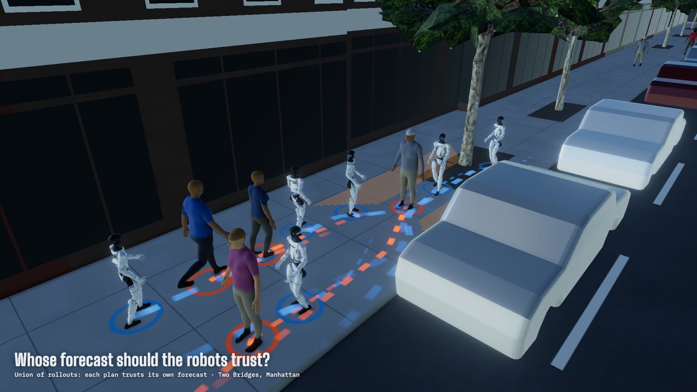</td>
<td width="33%"></td>
<td width="33%">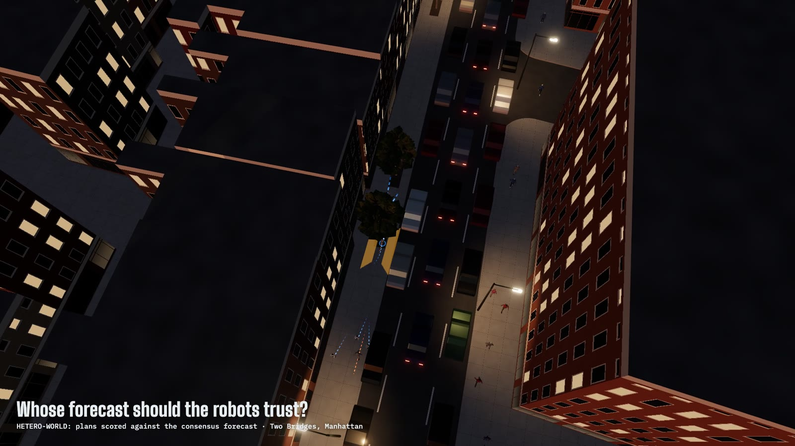</td>
</tr>
<tr><td align="center">Day · Union</td><td align="center">Dusk · HETERO-WORLD</td><td align="center">Aerial reveal</td></tr>
</table>

### BoundlessNYC replay (`twin/`)

The same episode replayed inside the open-source **BoundlessNYC** city engine, with its live traffic and walkers re-skinned as SOMA bodies:

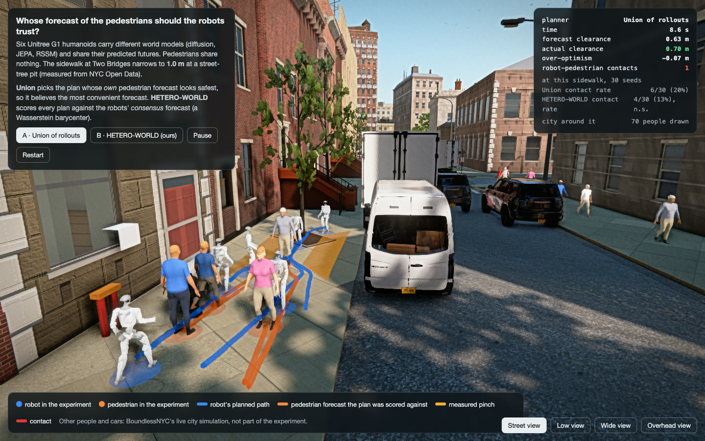

<table>
<tr>
<td width="60%">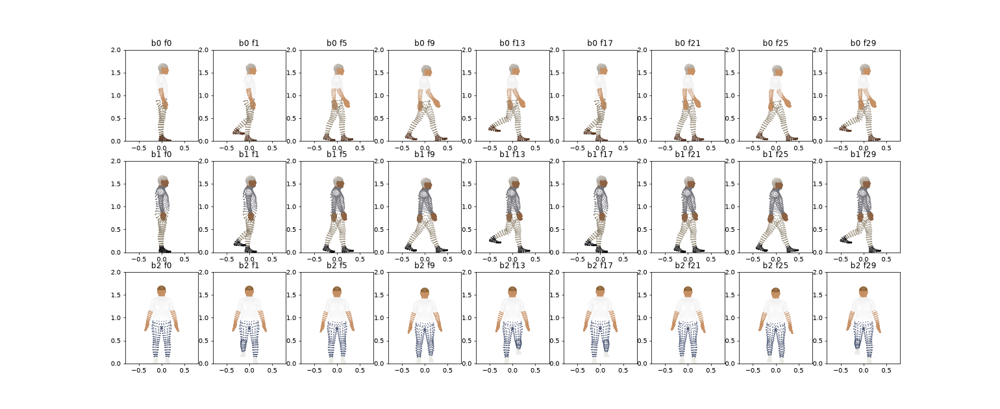</td>
<td width="40%">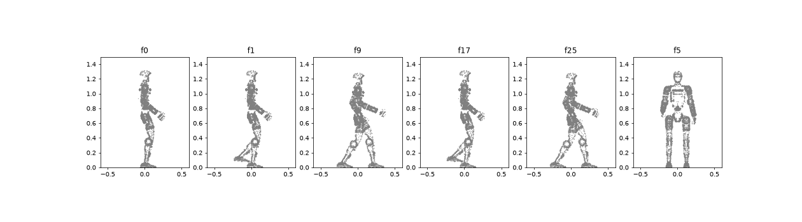</td>
</tr>
<tr><td align="center">SOMA-X walk cycles, posed with SOMA's own LBS (<code>twin/build_assets.py</code>)</td><td align="center">G1 gait via MuJoCo forward kinematics</td></tr>
</table>

---

## 🛠 Reproduce everything

```bash
# environment (uv)
uv venv .venv --python 3.12 && source .venv/bin/activate
uv pip install torch==2.14.1 numpy==2.5.3 scipy==1.18.1 shapely pytest matplotlib
python -m pytest -q                                  # 19 tests; test_latency_cpu_budget is a timing check and can fail on slow CPUs

# one closed-loop setting (3 run seeds x 100 episodes), then paired statistics
python scripts/make_jobs.py main --seeds 0 1 2 --episodes 100 > jobs/campaign.txt   # one line per 25-episode shard
python scripts/job_queue.py jobs/campaign.txt --workers 8 --respect-running          # resumable; skips finished shards
python scripts/analyze.py results/v2/main/h4 --ref hw_robust --out results/v2/main/h4/stats.json

# learned world models (pedestrian forecasts only; robot rows stay synthetic)
python scripts/run_benchmark.py --learned --learned-scope humans --methods hw_robust --humans 4 --seed 0 --episodes 25

# real pedestrians
python scripts/ethucy_prep.py && python scripts/ethucy_experiment.py

# NYC sidewalk geometry and scenarios
python scripts/nyc_pinch_points.py && python scripts/nyc_scenarios.py
python scripts/run_benchmark.py --sidewalk 2.95 0.81 3.09 --humans 4 --methods hw_robust,union_select

# WebGPU viewer, then the deterministic 1080p60 video (needs Chrome + ffmpeg)
uv pip install py-soma-x mujoco trimesh fast-simplification   # only to rebake the SOMA / G1 actors
python twin/build_assets.py && python docs/hw_viewer/build_data.py
node docs/hw_viewer/serve.mjs docs/hw_viewer          # http://127.0.0.1:5231/
(cd twin && npm install && node record_viewer.mjs ../figures/video/hetero_world_twobridges_1080p60.mp4)
```

<details>
<summary><b>Repository layout</b></summary>

| Path | What |
|---|---|
| `hetero_world/sinkhorn.py` | batched log-domain Sinkhorn, free-support barycenter |
| `hetero_world/controllers.py` | HETERO-WORLD and every baseline; `human_cost`, consistency term |
| `hetero_world/planner.py` | deterministic joint-plan scoring and selection |
| `hetero_world/env.py`, `config.py` | corridor simulator v2: reactive pedestrians, doorway courtesy, NYC sidewalks |
| `hetero_world/world_models.py`, `learned_models.py` | synthetic heterogeneous fleet; diffusion / JEPA / RSSM |
| `scripts/` | benchmark, queue, analysis, ETH/UCY, NYC geometry, figures |
| `results/` | every shard, plus `stats.json` per setting |
| `docs/hw_viewer/` | WebGPU twin and results page |
| `twin/` | BoundlessNYC replay, SOMA / G1 baking, video recorder |
| `figures/` | paper figures, README media, the video |

</details>

---

## 🚧 Limitations

- **Simulated interaction.** Pedestrians are reactive path followers with a hidden assertiveness trait, not a learned crowd model. The NYC
  sidewalks are a symmetric abstraction of measured widths: a one-sided pinch is implemented but not used, because the reactive pedestrians
  have no lateral avoidance.
- **Learned models forecast pedestrians only.** With robot rows also learned, robots imitate pedestrian-only training data and livelock at the doorway.
- **Safety is not improved.** Completion gains come with equal, and in two settings significantly higher, collision rates than Union.
- **The twin is a visualisation.** The six robots and four pedestrians on the sidewalk replay one recorded episode (seed 20250019). Across 30
  seeds at that sidewalk, contact is 20% (Union) vs 13% (ours), which is not significant. Everyone else in the scene is ambient life, and all
  gaits are procedural, not motion capture.

## 📚 Credits and licenses

- **NYC Open Data**: building footprints (5zhs-2jue), planimetric sidewalks (52n9-sdep), 2015 Street Tree Census (uvpi-gqnh).
- **ETH/UCY**: Pellegrini et al., ICCV 2009 (BIWI); Lerner et al., Eurographics 2007 (UCY). For research use.
- **NVIDIA SOMA-X** body model (Apache-2.0) · **Unitree G1** model via MuJoCo Menagerie (BSD-3-Clause) · **BoundlessNYC** (MIT; city data ODbL).
- **Street trees**: "[Tree low poly lowpoly](https://sketchfab.com/3d-models/tree-low-poly-lowpoly-73201f05280d48dcb10ed4ca362d69f8)" by [00amza](https://sketchfab.com/00amza), licensed under [CC-BY-4.0](http://creativecommons.org/licenses/by/4.0/).
- **Rendering**: three.js r186 (`WebGPURenderer`, TSL).

```bibtex
@inproceedings{heteroworld2027,
  title     = {HETERO-WORLD: Consensus Forecasts for Robot Fleets in Mixed Traffic via
               Wasserstein Barycenters of Heterogeneous World Models},
  author    = {Anonymous},
  booktitle = {Proc. of the 26th International Conference on Autonomous Agents and Multiagent Systems (AAMAS)},
  year      = {2027},
  note      = {Under review}
}
```
